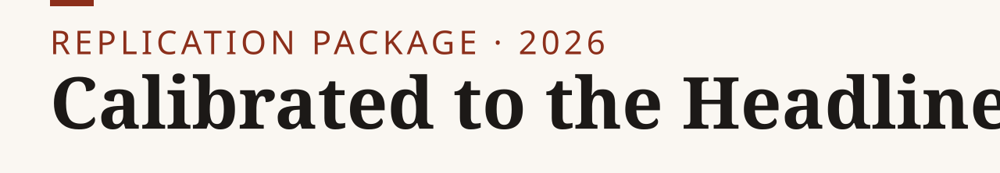
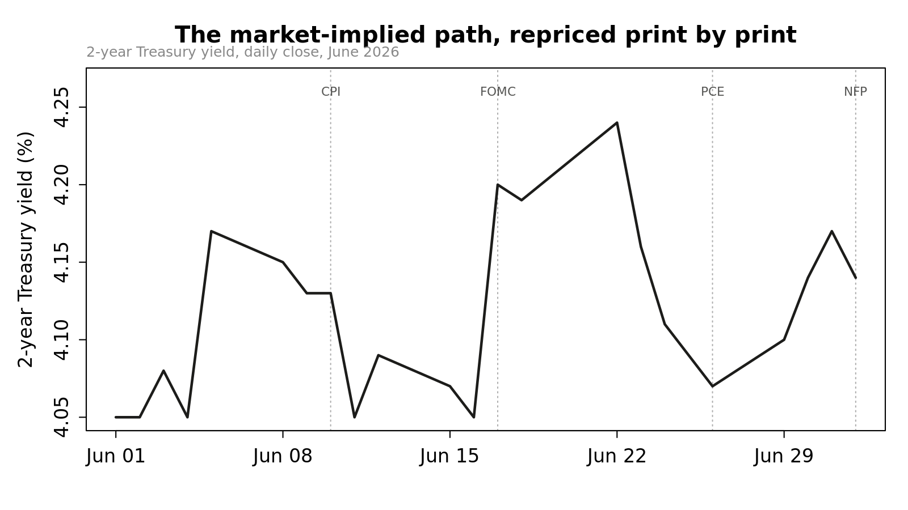

<p><picture><source media="(prefers-color-scheme: dark)" srcset="assets/banner-dark.svg"></picture></p>

**In June 2026 the 2-year Treasury yield was repriced four times in four weeks, from 4.13% to a 4.24% peak and back to 4.14%, driven as much by re-estimates of the committee as by news about the economy.**

[Paper](https://nikkhosravipour.com/post/calibrated-to-the-headline) · [Data](#data-availability) · [Site](https://nikkhosravipour.com)

[](https://doi.org/10.5281/zenodo.23404671) [](LICENSE) [](LICENSE-docs) [](https://www.r-project.org/)

<picture><source media="(prefers-color-scheme: dark)" srcset="output/figures/fig1_repricing-dark.png"></picture>

> [!NOTE]
> Needs R 4.0 or later and a free FRED API key. FRED data vintage 2026-09-08 (pinned in `R/config.R`). The published figures predate that pin; see [Data availability](#data-availability).

This is the replication package for the market note [*Calibrated to the Headline: Two Prints and the Path That Moved Between Them*](https://nikkhosravipour.com/post/calibrated-to-the-headline). R pulls daily and monthly macro series from FRED and produces Chart.js widgets and static PNG figures. They trace how the 2-year Treasury yield repriced across the June 2026 CPI, FOMC, PCE and payrolls releases, and how the inflation and labor-market data underneath evolved.

## Quick start

1. Clone: `git clone https://github.com/nik110403/fed-reaction-note.git && cd fed-reaction-note`
2. Install the packages: `Rscript -e 'install.packages(c("fredr", "dplyr", "zoo", "lubridate", "jsonlite"))'`
3. Get a free FRED API key at <https://fredaccount.stlouisfed.org/apikeys>, then `cp .Renviron.example .Renviron` and paste the key as `FRED_API_KEY=...`. R loads `.Renviron` from the project root.
4. Run everything from the repo root: `Rscript run_all.R`
5. Check the result: PNG figures in `output/figures/`, widgets in `output/widgets/`, tidy data in `output/data/note_export.csv`. The run also prints a block of key numbers (latest PCE, payroll and wage readings, 2-year yield closes around each event).

`run_all.R` stops with an error if it is called from a subdirectory.

## Exhibit map

| Exhibit | Script | Output |
|---|---|---|
| Figure 1: 2-year yield, June 2026, with event markers | `R/02_export_charts.R` | `output/figures/fig1_repricing.png`, `output/widgets/fig1_repricing.html` |
| Figure 2: PCE inflation decomposition | `R/02_export_charts.R` | `output/figures/fig2_decomposition.png`, `output/widgets/fig2_decomposition.html` |
| Figure 3: payrolls and wage growth | `R/02_export_charts.R` | `output/figures/fig3_collision.png`, `output/widgets/fig3_collision.html` |
| Source series, tidy | `R/01_data.R` | `output/data/note_export.csv` |

## Data availability

All data come from [FRED](https://fred.stlouisfed.org/) and are subject to its terms. They are public. The raw pulls archived under `data-raw/fred/2026-09-08/` are redistributed on that basis. They are not covered by the code licence.

| Series ID | Used in | Transformation |
|---|---|---|
| `DGS2` | Figure 1 | Levels, daily, 2026-06-01 to 2026-07-03 |
| `PCEPI` | Figure 2 | Year-over-year % (`pc1`), monthly |
| `PCEPILFE` | Figure 2 | Year-over-year % (`pc1`), monthly |
| `DNRGRG3M086SBEA` | Figure 2 | Year-over-year % (`pc1`), monthly |
| `PAYEMS` | Figure 3 | Monthly first difference, thousands |
| `CES0500000003` | Figure 3 | Year-over-year % (`pc1`), monthly |

Vintage and revisions:

- FRED revises `PCEPI`, `PCEPILFE`, `DNRGRG3M086SBEA`, `PAYEMS` and `CES0500000003` with each release and with benchmark revisions. Results reproduce exactly only against the vintage retrieved for the published note.
- The `DGS2` window is locked to 2026-06-01 through 2026-07-03 in `R/config.R` (`DGS2_START`, `DGS2_END`). The monthly series run from 2024-01-01 (`MONTHLY_START`) to whatever FRED reports as latest at pull time (`MONTHLY_END`).
- `R/config.R` pins `FRED_VINTAGE` (2026-09-08), passed as `realtime_start` and `realtime_end` on every FRED pull. The raw response is archived under `data-raw/fred/<FRED_VINTAGE>/`. The published figures predate this pin and reflect whatever FRED reported at publication time. Re-running `R/01_data.R` reproduces the FRED state as of `FRED_VINTAGE`, which diverges from the published numbers as FRED revises these series.
- `DGS2` has no weekend or holiday observations. The Figure 1 x-axis uses observed trading days only, and each event flag (CPI, FOMC, PCE, NFP) maps to the nearest observed date at or after the event date.

## Repository layout

```text
fed-reaction-note/
├── run_all.R          # runs 01 then 02, prints the key-numbers block
├── R/
│   ├── config.R           # packages, FRED key, paths, sample windows, event dates
│   ├── 01_data.R          # FRED pulls -> output/data/note_export.csv
│   └── 02_export_charts.R # Chart.js widgets and PNG figures
├── data-raw/fred/     # archived raw FRED pulls, by vintage date
├── output/
│   ├── data/
│   ├── figures/       # PNG figures
│   └── widgets/       # Chart.js fragments (*.html) and fenced embed versions (*.embed.md)
├── assets/            # banner and social preview (made by tools/banner)
├── .Renviron.example  # template for the FRED API key
├── CITATION.cff
├── LICENSE            # MIT (code)
└── LICENSE-docs       # CC BY 4.0 (text and figures)
```

The widgets follow the contract of the author's site: Chart.js 4.4.1 from jsDelivr only, no inline event handlers, theme set by the `is-light` class on `<html>`. The `*.embed.md` files are the same fragments wrapped in an `html-embed` fence for pasting into a post. The `*.html` files are unfenced, for local preview.

## Citation

Archived on Zenodo: [doi:10.5281/zenodo.23404671](https://doi.org/10.5281/zenodo.23404671) (all versions). GitHub shows a "Cite this repository" button from `CITATION.cff`. BibTeX:

<details>
<summary>BibTeX</summary>

```bibtex
@misc{fed_reaction_note2026,
  author = {Khosravipour, Nik},
  title  = {Calibrated to the Headline: Two Prints and the Path That Moved Between Them},
  year   = {2026},
  doi    = {10.5281/zenodo.23404671},
  url    = {https://github.com/nik110403/fed-reaction-note}
}
```

</details>

## License

Code: [MIT](LICENSE). Text and figures: [CC BY 4.0](LICENSE-docs). Third-party data (FRED) is not covered by either licence and stays subject to its source terms.
